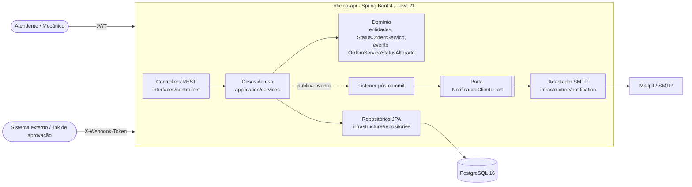
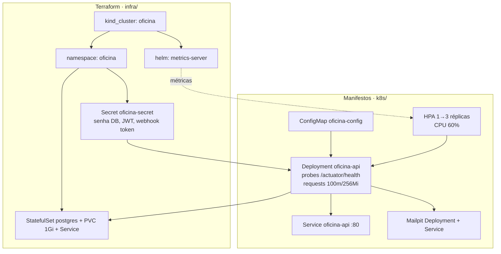
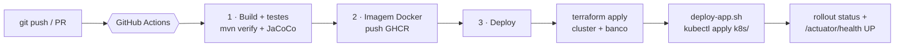

# Oficina API — System Integrated for Automotive Repair Shop

API REST desenvolvida como MVP para o gerenciamento integrado de oficinas mecânicas (**Tech Challenge - Fases 1 e 2**), aplicando os princípios do **Domain-Driven Design (DDD)**, boas práticas de Qualidade de Software e Segurança.

O sistema controla o ciclo de vida completo de ordens de serviço (OS), cadastro de clientes e veículos, catálogo de serviços, gestão e reserva de peças no estoque, autenticação segura via JWT e relatórios de monitoramento de desempenho.

---

## 🆕 Fase 2 — Qualidade, Resiliência e Escalabilidade

### Objetivos desta fase
Evoluir a aplicação da Fase 1 para suportar o crescimento da oficina (novas unidades e picos de ordens de serviço), com:
- **Infraestrutura escalável** em Kubernetes, com **escalabilidade automática (HPA)**;
- **Provisionamento automatizado** (Terraform) e **deploy automatizado** (CI/CD com GitHub Actions);
- **Código organizado** (Clean Code + portas/adaptadores) e **testes automatizados** dos fluxos críticos;
- **Novas APIs**: abertura completa de OS, consulta de status, aprovação de orçamento via webhook, listagem priorizada e notificação de status por e-mail.

### Novas APIs da Fase 2
| Método | Endpoint | Descrição | Autenticação |
|---|---|---|---|
| `POST` | `/ordens-servico/completa` | Abre a OS com **cliente + veículo + serviços + peças** e retorna o **id** da OS (201). Reaproveita cliente (CPF/CNPJ) e veículo (placa). | JWT |
| `GET` | `/ordens-servico/{id}/status` | Situação atual da OS (status, descrição e datas) | JWT |
| `POST` | `/webhooks/orcamento` | Notificação externa de **aprovação/recusa** do orçamento. Aprovado → `APROVADA`; recusado → `CANCELADA` (peças voltam ao estoque). Idempotente. | Header `X-Webhook-Token` |
| `GET` | `/ordens-servico` | Listagem **ordenada por prioridade**: Em Execução > Aprovada > Aguardando Aprovação > Em Diagnóstico > Recebida; mesmo status → **mais antigas primeiro**. Finalizadas, Entregues e Canceladas **não aparecem** (exclusão lógica). | JWT |
| — | *Notificação por e-mail* | A cada abertura/mudança de status o cliente recebe e-mail (SMTP; Mailpit em dev/K8s). Envio **após o commit** da transação. | — |
| `GET` | `/actuator/health` (`/liveness`, `/readiness`) | Health checks usados pelas probes do Kubernetes | Pública |

**Mapeamento de status (enunciado → sistema):** Recebida → `RECEBIDA` · Diagnóstico → `EM_DIAGNOSTICO` · Aguardando Aprovação → `AGUARDANDO_APROVACAO` · *(aprovação do orçamento)* → `APROVADA` · Execução → `EM_EXECUCAO` · Finalizada → `FINALIZADA` · Entregue → `ENTREGUE` · *(recusa)* → `CANCELADA`.

📬 **Collection Postman:** [`docs/oficina-api.postman_collection.json`](./docs/oficina-api.postman_collection.json) · 📘 **Swagger:** `http://localhost:8080/swagger-ui.html`

🎥 **Vídeo demonstrativo:** _<link do YouTube (não listado)>_

### Desenho da arquitetura

#### Componentes da aplicação


#### Infraestrutura provisionada


#### Fluxo de deploy (CI/CD)

> Em *pull requests* rodam os jobs 1 e 2; em *push* nas branches `fase-2`/`main` a pipeline completa (com deploy).

### Estrutura de pastas da Fase 2
```text
.github/workflows/ci-cd.yml   # Pipeline CI/CD
infra/                        # Terraform (cluster kind, metrics-server, namespace, secrets, PostgreSQL)
k8s/                          # Manifestos: ConfigMap, App (Deployment+Service), HPA, Mailpit
scripts/deploy-app.sh         # Publica a aplicação no cluster provisionado
scripts/deploy-k8s-local.sh   # Atalho: cria cluster + aplica tudo (sem Terraform)
docs/                         # Collection Postman
.devcontainer/                # Ambiente de desenvolvimento (Codespaces)
```

### Execução local (Docker Compose)
```bash
docker compose up -d --build
# API: http://localhost:8080/swagger-ui.html  ·  E-mails: http://localhost:8025 (Mailpit)
```

### Provisionamento da infraestrutura com Terraform
Pré-requisitos: Docker, Terraform ≥ 1.6, kubectl e kind (já inclusos no devcontainer). Detalhes em [`infra/README.md`](./infra/README.md).
```bash
cd infra
terraform init
terraform plan
terraform apply        # cria cluster, metrics-server, namespace, secret e PostgreSQL
cd ..
```

### Deploy em Kubernetes
```bash
bash scripts/deploy-app.sh                       # build da imagem + kubectl apply dos manifestos
kubectl get pods,svc,hpa -n oficina
kubectl port-forward svc/oficina-api 8080:80 -n oficina
kubectl port-forward svc/mailpit 8025:8025 -n oficina   # caixa de e-mails
```
Token do webhook gerado pelo Terraform:
```bash
kubectl get secret oficina-secret -n oficina -o jsonpath='{.data.WEBHOOK_TOKEN}' | base64 -d
```

### Demonstração da escalabilidade automática (HPA)
```bash
kubectl get hpa -n oficina -w            # terminal 1: acompanha as réplicas
kubectl run carga -n oficina --rm -it --image=busybox --restart=Never -- \
  sh -c "while true; do wget -q -O- http://oficina-api/v3/api-docs >/dev/null 2>&1; done"   # terminal 2
```
O HPA escala de **1 para até 3 réplicas** quando a CPU média passa de **60%** e reduz após a carga cessar.

### Destruir o ambiente
```bash
cd infra && terraform destroy
```

---

## 🚀 Tecnologias Utilizadas

- **Linguagem & Framework:** Java 21 | Spring Boot 4
- **Persistência:** Spring Data JPA | Hibernate
- **Banco de Dados:** PostgreSQL 16
- **Segurança:** Spring Security | JWT (JSON Web Token)
- **Validação:** Bean Validation | Validadores Customizados (CPF/CNPJ e Placa)
- **Containerização:** Docker | Docker Compose
- **Documentação:** Swagger UI / OpenAPI 3
- **Testes:** JUnit 5 | Mockito

---

## 📖 Como Usar a API (Guia de Utilização)

### 1. Acesso à Documentação Interativa (Swagger UI)
Após iniciar a aplicação, a documentação interativa e os testes de endpoints estarão disponíveis em:
👉 **Swagger UI:** [http://localhost:8080/swagger-ui.html](http://localhost:8080/swagger-ui.html)  
👉 **OpenAPI JSON Spec:** [http://localhost:8080/v3/api-docs](http://localhost:8080/v3/api-docs)

---

### 2. Autenticação JWT e Credenciais de Teste
A API utiliza autenticação **Bearer Token (JWT)** para proteger os endpoints administrativos.

#### 🔑 Credenciais Pré-Cadastradas (Banco de Dados Inicializado via Seed):
| Perfil | E-mail | Senha | Permissões |
| :--- | :--- | :--- | :--- |
| **Administrador** | `admin@oficina.com` | `Admin@123` | Acesso total a todas as rotas (Clientes, Veículos, Serviços, Peças, OS, Relatórios). |
| **Atendente** | `atendente@oficina.com` | `Admin@123` | Gestão de Clientes, Veículos, Abertura de OS e Atualização de Status. |
| **Mecânico** | `mecanico@oficina.com` | `Admin@123` | Diagnóstico, Adição de Peças/Serviços e Execução da OS. |

#### 🔄 Como Autenticar e Enviar Requisições:
1. Faça uma requisição `POST /auth/login`:
   ```json
   {
     "email": "admin@oficina.com",
     "senha": "Admin@123"
   }
   ```
2. O servidor retornará o token de acesso:
   ```json
   {
     "token": "eyJhbGciOiJIUzI1NiJ9..."
   }
   ```
3. **No Swagger UI:** Clique no botão verde **Authorize** (no topo à direita) e insira o valor `Bearer <SEU_TOKEN_JWT>`.
4. **No Postman / cURL:** Adicione o cabeçalho HTTP:
   `Authorization: Bearer <SEU_TOKEN_JWT>`

---

### 3. Fluxo Prático do Ciclo de Vida da Ordem de Serviço (OS)

#### Step 1: Cadastrar Cliente
- **Endpoint:** `POST /clientes`
- **Body:**
  ```json
  {
    "nome": "Carlos Andrade",
    "cpfCnpj": "11144477735",
    "email": "carlos@email.com",
    "telefone": "11977776666"
  }
  ```

#### Step 2: Cadastrar Veículo para o Cliente
- **Endpoint:** `POST /veiculos`
- **Body:**
  ```json
  {
    "placa": "BRA2E19",
    "marca": "Chevrolet",
    "modelo": "Onix",
    "ano": 2023,
    "clienteId": 1
  }
  ```

#### Step 3: Abrir Ordem de Serviço
- **Endpoint:** `POST /ordens-servico`
- **Body:**
  ```json
  {
    "veiculoId": 1,
    "descricaoProblema": "Motor falhando em marcha lenta e barulho no freio"
  }
  ```
  *(Status inicial gerado automaticamente: `RECEBIDA`)*

#### Step 4: Diagnóstico e Adição de Itens
1. **Mover para Diagnóstico:** `PATCH /ordens-servico/1/status` `{"status": "EM_DIAGNOSTICO"}`
2. **Adicionar Serviço:** `POST /ordens-servico/1/servicos` `{"servicoId": 1}`
3. **Adicionar Peça (Reserva Estoque):** `POST /ordens-servico/1/pecas` `{"pecaId": 1, "quantidade": 2}`

#### Step 5: Aprovação, Execução e Entrega
1. **Aguardar Aprovação:** `PATCH /ordens-servico/1/status` `{"status": "AGUARDANDO_APROVACAO"}`
2. **Aprovar Orçamento:** `PATCH /ordens-servico/1/status` `{"status": "APROVADA"}`
3. **Iniciar Execução:** `PATCH /ordens-servico/1/status` `{"status": "EM_EXECUCAO"}` *(Registra data/hora início)*
4. **Finalizar Serviço:** `PATCH /ordens-servico/1/status` `{"status": "FINALIZADA"}` *(Registra data/hora término)*
5. **Entregar Veículo:** `PATCH /ordens-servico/1/status` `{"status": "ENTREGUE"}`

#### Step 6: Consultar Relatório de Desempenho (Tempo Médio)
- **Endpoint:** `GET /ordens-servico/relatorios/tempo-medio-execucao`
- **Resposta:**
  ```json
  {
    "totalOrdensFinalizadas": 1,
    "tempoMedioEmMinutos": 15.0,
    "tempoMedioFormatado": "15 minuto(s)"
  }
  ```

---

## 🗄️ Justificativa da Escolha do Banco de Dados

A escolha do **PostgreSQL** como SGBD relacional justifica-se pelos seguintes fatores principais:
1. **Garantias ACID:** Ordens de serviço, itens de peças e estoque exigem estrita consistência transacional para evitar *race conditions* em reservas de estoque e divergências financeiras no valor final do orçamento.
2. **Integridade Referencial Forte:** Suporte a chaves estrangeiras com regras em cascata (`ON DELETE CASCADE`) entre Clientes, Veículos e Ordens de Serviço, assegurando a rastreabilidade do histórico.
3. **Escalabilidade e Confiabilidade:** SGBD open-source maduro, amplamente adotado em ambiente produtivo e com ecossistema robusto para containers Docker.

---

## 📌 Funcionalidades Principais & Linguagem Ubíqua

- **Criação e Fluxo da Ordem de Serviço (OS):**
  - Status gerenciados segundo o Event Storming: `RECEBIDA` ➔ `EM_DIAGNOSTICO` ➔ `AGUARDANDO_APROVACAO` ➔ `APROVADA` ➔ `EM_EXECUCAO` ➔ `FINALIZADA` ➔ `ENTREGUE` (ou `CANCELADA`).
  - Restrição de adição de peças e serviços exclusivamente durante a fase de `EM_DIAGNOSTICO`.
  - Estorno e devolução automática de peças reservadas ao estoque caso a OS seja cancelada.
- **Monitoramento do Tempo Médio de Execução:**
  - Endpoint dedicado `GET /ordens-servico/relatorios/tempo-medio-execucao` para acompanhar a duração média (em minutos e horas) dos serviços prestados entre o início da execução e a finalização.
- **Validação Robusta de Dados Sensíveis:**
  - Verificação de CPF (11 dígitos) e CNPJ (14 dígitos) com algoritmos de dígitos verificadores.
  - Validação de placas de veículos nos formatos tradicional (`ABC1234`) e Mercosul (`ABC1D23`).
- **Autenticação & Controle de Acesso:**
  - Autenticação JWT para APIs administrativas (`POST /auth/login`).

---

## 🏛️ Arquitetura do Projeto

O projeto utiliza uma estrutura monolítica em camadas baseada no DDD:

```text
src/main/java/br/com/fiap/oficina
│
├── application
│   └── services             # Regras de aplicação e casos de uso
│
├── config                   # Configurações de segurança (JWT), CORS e OpenAPI
│
├── domain                   # Entidades ricas de domínio e regras de negócio
│   ├── cliente
│   ├── veiculo
│   ├── servico
│   ├── peca
│   ├── ordemservico
│   └── usuario
│
├── infrastructure
│   └── repositories         # Repositórios JPA de acesso aos dados
│
└── interfaces               # Camada de entrada/saída (HTTP REST)
    ├── controllers          # Endpoints RESTful
    ├── dtos                 # Objetos de transferência de dados (Records)
    ├── validation           # Validadores customizados (@CpfCnpj, @PlacaVeiculo)
    └── exceptions           # Tratamento global de exceções (GlobalExceptionHandler)
```

---

## 🛠️ Como Executar Localmente

### Pré-requisitos
- Docker & Docker Compose
- Java 21 + Maven 3.9+ (caso vá rodar localmente sem Docker)

### Execução via Docker Compose (Recomendado)

1. Suba o ambiente (PostgreSQL + Aplicação) com os scripts de inicialização (`init-scripts/`):
   ```bash
   docker-compose up -d --build
   ```
2. A aplicação estará acessível em: `http://localhost:8080`
3. Documentação Swagger UI: `http://localhost:8080/swagger-ui.html`

### Execução Local (Desenvolvimento)

> 💡 **Nota sobre a versão do Java:** O projeto utiliza **Java 21**. Para compilar diretamente no terminal via `.\mvnw.cmd`, certifique-se de que o JDK 21 esteja configurado no seu `JAVA_HOME`. Caso seu ambiente local possua um Java inferior (ex: Java 11/17), utilize a **Execução via Docker Compose**, que compila o projeto dentro de um container isolado com JDK 21.

1. Suba apenas o banco de dados PostgreSQL:
   ```bash
   docker-compose up -d postgres
   ```
2. Execute a aplicação via Maven Wrapper (com JDK 21 configurado):
   ```bash
   ./mvnw spring-boot:run
   ```

---

## 🧪 Execução dos Testes & Roteiros Detalhados

- **Testes Automatizados:** Para executar a suíte de testes unitários e de integração:
  ```bash
  ./mvnw clean test
  ```

- **Roteiro de Validação Funcional:** Consulte o arquivo **[ROTEIRO_DE_TESTES.md](./ROTEIRO_DE_TESTES.md)** para obter o guia detalhado contendo o passo a passo completo das requisições para validação do sistema via Swagger UI ou Postman.

- **Relatório de Segurança & Vulnerabilidades (OWASP ZAP):** Consulte o arquivo **[RELATORIO_SEGURANCA_OWASP_ZAP.md](./RELATORIO_SEGURANCA_OWASP_ZAP.md)** contendo a análise detalhada de varredura DAST contra as regras do OWASP Top 10 API Security Risks.

- **Manual de Testes de Segurança:** Consulte o arquivo **[MANUAL_TESTES_SEGURANCA.md](./MANUAL_TESTES_SEGURANCA.md)** para o guia passo a passo de como executar análises estáticas (SAST - Dependency Check) e dinâmicas (DAST - OWASP ZAP) na aplicação.